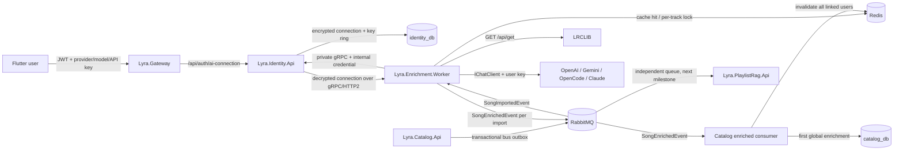

# Requirements

### Overview & Goals

Catalog ingestion is complete. This milestone builds the **end-user-configurable AI foundation and asynchronous enrichment pipeline**. It replaces the `Lyra.Enrichment.Worker` heartbeat stub with a MassTransit consumer, introduces reusable provider adapters, lets each user securely configure their own AI provider and API key, and completes enrichment back into `Lyra.Catalog.Api`.

When this is done:

- An authenticated user can select **OpenAI, Gemini, OpenCode Console, or Anthropic Claude**, provide a model ID and their own API key, and replace or remove that connection through Identity endpoints.
- API keys are encrypted at rest in `identity_db`, are never returned by user-facing read endpoints, and are never placed in RabbitMQ messages, logs, Redis, Catalog, or playlists.
- `Lyra.Enrichment.Worker` consumes `SongImportedEvent`, resolves the current user's connection through Identity's private gRPC service, fetches plain lyrics from LRCLIB, and obtains structured `PrimaryMood`, `Themes`, and `EnergyLevel` output through `IChatClient`.
- A shared `Lyra.AI` class library owns provider-specific chat-client creation and error normalization. Enrichment logic depends only on `Microsoft.Extensions.AI`, not on individual SDK types.
- Every successfully processed import publishes a `SongEnrichedEvent`, including imports from another user for an already-global track so the future per-user RAG consumer is not starved.
- Repeated work for the same global track is reduced by a Redis enrichment-result cache and per-track execution lock, while enrichment results remain free of user credentials and user identifiers.
- `Lyra.Catalog.Api` consumes `SongEnrichedEvent`, updates the shared global track exactly once for the first successful result, serializes themes consistently, sets `IsEnriched`, and invalidates cached library pages for **every user linked to that track**.
- Lyrics-not-found is not a failure: the LLM still performs metadata-only enrichment. Transient dependency failures use bounded exponential retry; invalid credentials, unsupported models, and malformed results do not produce fabricated enrichment.
- Unit/integration tests fake all live AI and LRCLIB boundaries, use the MassTransit in-memory harness, and retain real PostgreSQL integration coverage for database-owned behavior.

### Scope

**In Scope**

1. **`Lyra.AI` class library (new)**
   - A common factory around `IChatClient` with adapters for OpenAI, Gemini, OpenCode Console, and Anthropic Claude.
   - Fixed provider endpoint selection, model/key validation, per-request client lifetime, sanitized transient/permanent error classification, and DI registration reusable by later services.
   - No provider business prompts, persistence, database, or web endpoints in this library.

2. **`Lyra.Contracts`**
   - Shared provider/plan enums and the internal AI-connection DTO needed by Identity and Worker.
   - Existing `SongImportedEvent` and `SongEnrichedEvent` remain unchanged.

3. **`Lyra.Identity.Api` — end-user BYOK settings**
   - One current AI connection per user (`Provider`, `Model`, encrypted `ApiKey`, and OpenCode plan when applicable).
   - Authenticated get/upsert/delete endpoints returning metadata only.
   - ASP.NET Core Data Protection for encryption, with its key ring persisted through Identity's own EF Core context.
   - A private worker-only gRPC service that decrypts and returns the connection for a requested user. It runs on a separate HTTP/2 listener, is not routed through the public Gateway, and requires a separate deployment-managed internal service credential.

4. **`Lyra.Enrichment.Worker`**
   - RabbitMQ consumption with `PrefetchCount = 3`, `ConcurrentMessageLimit = 3`, bounded exponential retry, and an in-memory consumer outbox.
   - Identity internal-client integration, LRCLIB `/api/get`, structured LLM analysis, semantic-summary construction, and `SongEnrichedEvent` publication.
   - Redis enrichment-result caching and per-track distributed locking, without adding a Worker database or making the Worker stateful between process restarts.

5. **`Lyra.Catalog.Api`**
   - `SongEnrichedEvent` consumer and enrichment application service/repository methods.
   - Idempotent global-track updates, canonical themes JSON, consumer inbox/outbox integration, and cache invalidation for all linked users.
   - Replace the current read/modify/write numeric cache version increment with an opaque fresh version token so concurrent invalidations cannot accidentally reuse a stale counter value.

6. **Tests, solution, and documentation**
   - New `tests/Lyra.AI.Tests/` and `tests/Lyra.Enrichment.Worker.Tests/` projects.
   - Expanded Identity and Catalog tests, all new projects registered in `Lyra.slnx`.
   - Request examples, `.env.example`, `README.md`, `docs/ARCHITECTURE.md`, `CHANGELOG.md`, and `AGENTS.md` updates for the new shared library and Identity-owned BYOK responsibility.

**Out of Scope**

- `Lyra.PlaylistRag.Api`, embeddings, `pgvector` schema changes, and `POST /api/playlists/generate` — the following milestone.
- Selecting embedding models or implementing `IEmbeddingGenerator` adapters. This milestone creates chat clients only; the following plan must define embedding configuration explicitly.
- Flutter UI changes. The backend endpoints and request examples are the client contract for a later client integration.
- ChatGPT Plus/Pro OAuth sign-in. “OpenAI” means an OpenAI Platform API key, not use of a ChatGPT subscription through OAuth.
- Azure OpenAI, Vertex AI, Bedrock, OpenRouter, arbitrary OpenAI-compatible base URLs, local Ollama, and additional providers.
- A second AI failure-status field or per-user enrichment status UI. Failed messages remain unenriched and are observable through retries/error queues.
- Editing global track metadata after ingestion, audio uploads, and synchronous enrichment during `POST /api/catalog/tracks/batch`.

### User Stories

- As a user, I want to choose my AI provider and model and supply my own API key so enrichment usage is billed to my own provider account.
- As a user, I want to replace or delete my AI connection without Lyra ever returning my secret key.
- As a service owner, I want one provider-neutral AI integration library so enrichment and later RAG work do not duplicate provider setup.
- As a user, I want my imported songs enriched asynchronously with lyrics, mood, themes, and energy without delaying catalog ingestion.
- As a user whose song has no LRCLIB match, I still want useful metadata-only mood/theme/energy enrichment.
- As a user, I want my library's enrichment indicator refreshed after processing, including when another user's import enriched the same global track.
- As a service owner, I want transient provider/LRCLIB failures retried safely and permanent configuration failures isolated without corrupting catalog data.
- As a service owner, I want each user's imported-track event retained downstream even when expensive enrichment content can be reused across users.

### Functional Requirements

#### AI connection management

| Endpoint | Behavior |
|---|---|
| `GET /api/auth/ai-connection` | Requires the user's bearer JWT. Returns `200` with `Provider`, `Model`, optional `OpenCodePlan`, `CreatedAt`, and `UpdatedAt`; returns `404` when no connection exists. Never returns the API key or protected key text. |
| `PUT /api/auth/ai-connection` | Requires auth. Validates and atomically creates or replaces the caller's single connection, encrypting a nonblank API key before persistence. Returns `200` with non-secret metadata. Replaces the key on every successful upsert; there is no silent “keep the old key” sentinel. |
| `DELETE /api/auth/ai-connection` | Requires auth. Deletes only the caller's connection and returns `204`; repeated deletion remains `204`. |
| gRPC `UserAiConnectionService/GetAiConnection` | Runs on Identity's private HTTP/2 listener (`5004` in Development). Requires `x-lyra-internal-key` metadata, not an end-user JWT. Returns the decrypted connection or gRPC `NotFound`; invalid input and missing credentials map to `InvalidArgument` and `Unauthenticated`. Not routed by `Lyra.Gateway`. |

- Valid providers are exactly `OpenAI`, `Gemini`, `OpenCode`, and `Anthropic`.
- `Model` is trimmed, nonblank, and bounded; `ApiKey` is nonblank and bounded to protect request bodies/storage. A provider/model compatibility check is not simulated locally.
- `OpenCodePlan` is required for `OpenCode` and must be `PayAsYouGo` or `Go`; it must be null for every other provider.
- The user endpoints always derive `UserId` from the authenticated principal, never from request input.
- Only one connection exists per user. Updating it affects messages processed afterward; already-running work may finish with the connection snapshot it already obtained.
- API keys travel only over protected transport. Non-development deployments must use HTTPS for public and internal calls.
- No deployment-wide AI provider/key fallback is used: a missing user connection is a permanent, actionable processing error.

#### Provider adapter behavior

| Provider | Implementation through `IChatClient` |
|---|---|
| `OpenAI` | Official OpenAI client through `Microsoft.Extensions.AI.OpenAI`; user Model ID and API key. |
| `Gemini` | Official `Google.GenAI` client and its `AsIChatClient(model)` adapter. |
| `Anthropic` | Official `Anthropic` package version 10 or later and its `AsIChatClient` adapter, with a bounded configured maximum output-token count. |
| `OpenCode` | OpenCode Console's OpenAI Chat Completions API through `Microsoft.Extensions.AI.OpenAI`. `PayAsYouGo` maps to `https://opencode.ai/inference/openai/v1`; `Go` maps to `https://opencode.ai/inference/go/openai/v1`. Include a stable `x-opencode-session` value derived from the received message/correlation ID, preserving it across retries. Do not accept arbitrary endpoint URLs. OpenCode free-tier chat models are not available to external clients such as Lyra; users need an eligible paid model or Go plan. |

- All adapters expose the same `IChatClient` surface. `TrackEnrichmentService` never references an OpenAI, Google, Anthropic, or OpenCode SDK type.
- Clients are created for the current user's connection and safely disposed after use. They are not registered as one global singleton selected at application startup.
- Authentication failures, bad requests, unknown models, permission errors, and unsupported structured-output behavior are permanent failures for that connection.
- Network failures, request timeouts, HTTP `408`, `429`, and `5xx` are transient failures eligible for bounded retry. Provider error details are logged only in sanitized form and never include API keys, prompts, lyrics, or response bodies.

#### Enrichment behavior

1. Receive `SongImportedEvent` and look for a cached `TrackEnrichmentResult` by global `TrackId`.
2. On a cache miss, acquire a short-lived Redis lock for that `TrackId` and check the cache again. Lock contention is transient so MassTransit can retry rather than duplicate concurrent external calls.
3. Resolve the importing user's current AI connection through Identity's private endpoint. No plaintext key is included in any event or cache entry.
4. Query LRCLIB with URL-encoded `track_name` and `artist_name`; include `album_name` when nonblank and `duration` only when LRCLIB's supported range permits it.
   - `200`: use `plainLyrics`, including `null` for an instrumental record.
   - `404`: continue with `Lyrics = null`.
   - `429`, timeout, and `5xx`: fail transiently for retry rather than silently treating an outage as “no lyrics”.
5. Ask the selected model for structured output corresponding to `TrackAnalysis(PrimaryMood, Themes, EnergyLevel)` using `GetResponseAsync<TrackAnalysis>` and a JSON schema.
   - Lyrics are source data, never instructions. Metadata and lyrics are serialized as bounded data in the prompt to reduce prompt-injection ambiguity.
   - Lyrics used in the prompt are bounded by a configured character limit to control tokens; full plain lyrics are still retained in the result/event.
   - Without lyrics, perform the same analysis from title/artist/album/duration metadata only.
6. Validate the typed result before publishing:
   - `PrimaryMood` is nonblank after trimming and fits Catalog's 128-character column.
   - `Themes` is a required list. Trim entries, discard null/blank entries, and remove duplicates case-insensitively while preserving order; an empty list after normalization is valid when the model finds no reliable themes.
   - `EnergyLevel` is between 1 and 10 inclusive.
   - Deserialization or validation failure causes no fallback tags and no `SongEnrichedEvent` publication.
7. Build a deterministic `SemanticSummary` from title, artist, optional album, primary mood, ordered themes, and energy level. Do not append full lyrics to the summary, keeping the later embedding input bounded.
8. Cache only shared enrichment content (`Lyrics`, `PrimaryMood`, `Themes`, `EnergyLevel`, `SemanticSummary`) under `enrichment:tracks:{trackId}:v1` with a configured long-lived TTL. Never cache the user ID, provider key, or provider credentials in that payload.
9. Publish `SongEnrichedEvent` with the original `TrackId` and `UserId`, nullable full lyrics, validated fields, summary, and current UTC `EnrichedAt`.
10. On a cache hit, skip Identity, LRCLIB, and LLM calls but still publish an event for the current import's `UserId`.

#### Catalog completion behavior

- `SongEnrichedConsumer` delegates to a Catalog-owned application service and does not query any other service's database.
- Catalog loads the target track by `TrackId`, applies the supplied fields, serializes `Themes` as a JSON array string in `Track.Themes`, and sets `IsEnriched = true`.
- The first successful enrichment applied to a global track wins. A duplicate or later event for an already-enriched track does not overwrite lyrics/tags or reset enrichment status.
- A successful first enrichment commits before cache invalidation. All `UserId`s linked through `user_tracks` are invalidated, not only `SongEnrichedEvent.UserId`.
- Cache invalidation writes a fresh opaque GUID version token instead of incrementing an integer through `IDistributedCache`. Existing page keys continue to include the version value, so replacing it makes all old page entries unreachable.
- A library cache lookup also returns the exact version token used for that lookup. `TrackQueryService` passes the same token back when filling a cache miss; it must not re-read a newer version after a slow database query. A late stale fill therefore remains under an obsolete key rather than becoming current.
- Missing `TrackId` is treated as an integrity error and is not converted into a successful no-op.
- Catalog's enriched-event receive endpoint uses its EF Core consumer outbox/inbox so duplicate deliveries are detected and state processing is safely persisted. The existing bus outbox used for importing remains unchanged.

### Non-Functional Requirements

- Preserve strict database-per-service isolation: Identity owns `identity_db`, Catalog owns `catalog_db`, and Worker has no database or EF Core context.
- Do not share Identity `DbContext`, user keys, protected key strings, or data-protection keys with Worker.
- Keep MassTransit on Apache-licensed `8.5.x`; the existing `8.5.7` reference must not be upgraded to v9.
- Keep all provider access behind `Microsoft.Extensions.AI.IChatClient`; no alternative AI abstraction or Semantic Kernel layer.
- All I/O, EF Core operations, Redis operations, HTTP calls, AI calls, and publish operations are asynchronous and propagate `CancellationToken`.
- Background consumers use primary constructors. Records remain the default for immutable DTOs/results; mutable EF entities remain classes.
- Bound external-request timeouts, output tokens, lyrics prompt size, retry count/delay, Redis lock lifetime, and consumer concurrency through configuration.
- LRCLIB requests are rate-conscious: use a descriptive User-Agent, avoid parallel bursts, and enforce a configurable short interval between requests per Worker instance in addition to `PrefetchCount = 3`.
- Use stable structured log properties such as `TrackId`, `UserId`, provider, model, and correlation/message ID. Do not log secrets, authorization headers, protected key text, complete provider exceptions containing request data, prompts, lyrics, or cached payloads.
- New public operations continue to use existing JWT issuance/validation and the existing Gateway route/limiter. Because `/api/auth/*` is anonymously forwarded, the new endpoints themselves must require authorization. No authentication token contract changes.
- No API key, internal service credential, or data-protection production credential is committed. `.env.example` contains placeholders only.
- `dotnet build Lyra.slnx` and the existing Identity/Catalog tests must remain green after each delivery step.

# Technical Design

### Current Implementation

- `Lyra.slnx` already contains all six production projects but only the Identity and Catalog test projects.
- `Lyra.Enrichment.Worker/Worker.cs` is still the generated one-second heartbeat. `Program.cs` registers no MassTransit bus, LRCLIB client, AI client, Redis connection, or enrichment services.
- Both song event records already exist under `Lyra.Contracts/Events`. `SongImportedEvent` carries user and track metadata; `SongEnrichedEvent` carries `TrackId`, `UserId`, lyrics, mood, themes, energy, summary, and timestamp.
- `Lyra.Identity.Api` owns users and JWT authentication. It has no per-user AI settings or data-protection-key entity yet.
- `Lyra.Catalog.Api.Models.Track` already has all required enrichment fields: `IsEnriched`, `Lyrics`, `PrimaryMood`, nullable string `Themes`, `EnergyLevel`, and `SemanticSummary`. Therefore applying enrichment needs no additional track columns or migration.
- `TrackIngestionService` intentionally publishes one `SongImportedEvent` per newly created user-track link. Two users sharing a global track therefore yield two import events, and existing tests assert this behavior.
- Catalog has a MassTransit EF Core bus outbox but currently has no consumers and no enriched-event receive-endpoint inbox configuration.
- `ILibraryCache.InvalidateAsync` is reusable, but its current numeric increment is a non-atomic distributed-cache read/modify/write.
- `Lyra.Gateway` already forwards `/api/auth/*` to Identity without Gateway authorization and applies the shared auth limiter. The new BYOK endpoints fit the existing route without a cluster/transform change, but each must explicitly require JWT authorization in Identity.
- RabbitMQ, Redis, and both databases already exist in local infrastructure. No new infrastructure container is needed.

### Key Decisions

1. **Create `Lyra.AI`, not provider code in Contracts or individual services.** `Lyra.Contracts` remains limited to shared contracts/authentication. `Lyra.AI` owns provider SDK references and returns standard `IChatClient` instances. The upcoming RAG service can reference this library rather than copying providers.
2. **Identity owns user AI settings because they are per-account secrets and preferences.** No new microservice/database is introduced for a single user-owned settings record. Worker accesses the record through Identity's private interface, never by opening `identity_db`.
3. **Secrets never enter asynchronous contracts.** `SongImportedEvent` and `SongEnrichedEvent` stay unchanged. Only the internal Identity response carries decrypted key material, and it is used immediately to construct the provider client.
4. **Reuse enrichment content but preserve per-user events.** Redis avoids obvious repeated external calls for the same global `TrackId`, while every incoming user-linked import still produces a `SongEnrichedEvent`. This supports the existing global Catalog model and future per-user RAG storage simultaneously.
5. **Cache is an optimization, not the system of record.** Catalog remains authoritative for applied global enrichment. Cache expiry or a process crash can cause extra provider usage, but cannot break ownership or corrupt workflow. The Worker remains stateless regarding its own durable schema.
6. **First applied global result wins.** At-least-once delivery and multiple user events are unavoidable. Catalog does not churn shared metadata on later results; future RAG consumers still receive their own user-scoped event independently from RabbitMQ.
7. **MassTransit in-memory outbox in Worker; EF consumer outbox in Catalog.** Worker has no durable state to combine with a transactional outbox. The receive-endpoint outbox prevents failed attempts from emitting partial events, and downstream consumers remain idempotent. Catalog persists its consumer inbox with its own database transaction.
8. **OpenCode is a fixed-provider adapter, not generic custom endpoints.** Users choose Pay-as-you-go or Go and a model; backend code selects the documented endpoint. This avoids accepting arbitrary URLs and the associated SSRF risk. A stable session header is required for Console routing/Go behavior.
9. **No fabricated fallback on AI failure.** Only LRCLIB `404` triggers metadata-only analysis. Permanent AI errors leave the track pending/unenriched and send the message to the configured error path after policy handling.
10. **Opaque cache version tokens plus version-stable fills fix both cache races with minimal change.** A fresh token changes the version namespace even when invalidations overlap, avoiding stale-read/increment behavior without another Redis client in Catalog. Reusing the lookup's token on `SetLibraryAsync` separately prevents a slow pre-invalidation database result from being stored under a post-invalidation version.

### Proposed Changes

#### `Lyra.AI` — centralized provider adapters

Create a .NET 10 class library registered in `Lyra.slnx`:

- `AiChatClientFactory` resolves the appropriate `IAiChatClientProvider` for `AiConnectionSecret.Provider` and returns a scoped `IChatClient` for the supplied model/key.
- Provider implementations:
  - `Providers/OpenAiChatClientProvider.cs`
  - `Providers/GeminiChatClientProvider.cs`
  - `Providers/ClaudeChatClientProvider.cs`
  - `Providers/OpenCodeChatClientProvider.cs`
- `AiProviderException` carries provider and transient/permanent classification with a sanitized message. Adapter-specific exception mapping belongs here.
- `AiProviderOptions` supplies bounded common settings such as request timeout/max output tokens to adapters; no user API keys are bound from deployment configuration.
- `DependencyInjection.cs` exposes `AddLyraAiProviders()` and registers only factories/adapters/options, not a single selected user's `IChatClient`.
- Package references include `Microsoft.Extensions.AI`, a compatible `Microsoft.Extensions.AI.OpenAI`, `Google.GenAI`, and official `Anthropic` 10+; verify the resolved package graph against the existing `Microsoft.Extensions.AI` version at implementation time.

#### `Lyra.Contracts` — provider and internal-connection contracts

Add `AI/AiProvider.cs`, `AI/OpenCodePlan.cs`, and `AI/AiConnectionSecret.cs`:

```csharp
public enum AiProvider
{
    OpenAI = 1,
    Gemini = 2,
    OpenCode = 3,
    Anthropic = 4
}

public enum OpenCodePlan
{
    PayAsYouGo = 1,
    Go = 2
}

// Internal service-to-service contract only: never publish this record.
public sealed record AiConnectionSecret(
    AiProvider Provider,
    string Model,
    string ApiKey,
    OpenCodePlan? OpenCodePlan);
```

Do not add API keys to either song event or to public connection-response DTOs.

#### `Lyra.Identity.Api` — BYOK ownership and secret protection

Following existing Identity layering:

- Add `Models/UserAiConnection` with `UserId` as primary key, `Provider`, `Model`, `ProtectedApiKey`, nullable `OpenCodePlan`, `CreatedAt`, and `UpdatedAt`. Cascade deletion with its owning user if the current Identity model supports that relationship.
- Extend `Data/IdentityDbContext` with `DbSet<UserAiConnection>`, provider/plan persistence, model/protected-key lengths, timestamps, and the Data Protection key set. Implement `IDataProtectionKeyContext` and add `DbSet<DataProtectionKey>`.
- Register `AddDataProtection().PersistKeysToDbContext<IdentityDbContext>()` with a stable application name and a purpose-specific protector such as `Lyra.Identity.UserAiConnection.v1`.
- Add an EF Core migration creating `user_ai_connections` and `data_protection_keys`. The key-ring table lets all Identity instances decrypt existing payloads after restart; production deployment must additionally protect the key ring using deployment-managed certificate/key protection appropriate to that environment.
- Add `Services/AiConnections/IUserAiConnectionService` and primary-constructor implementation for get/upsert/delete plus internal lookup/decryption.
- Add request/response DTOs and `Endpoints/AiConnectionEndpoints` at `/api/auth/ai-connection` with `.RequireAuthorization()` applied explicitly to its group/endpoints. The existing Gateway `auth-route` forwards anonymously and the existing `/api/auth` group is not globally protected, so endpoint authorization is mandatory. Responses contain no `ProtectedApiKey` and no plaintext key.
- Add a narrowly scoped internal-service gRPC interceptor for `UserAiConnectionService`. Use a high-entropy deployment secret from `InternalServices:ApiKey` in `x-lyra-internal-key` metadata and constant-time credential comparison. Map the service with `MapGrpcService` on a separate HTTP/2 listener; non-Development deployments require an HTTPS gRPC URL.
- Public unknown provider/plan/model/key validation errors use existing Identity validation/AppStrings/problem-details conventions. Internal decryption failures are server errors, never echoed with protected or plaintext values.

#### `Lyra.Enrichment.Worker` — dependency clients and cache

- Replace heartbeat registration with numbered host composition: root `.env` loading via DotNetEnv, validated options, MassTransit, typed HTTP clients, Redis, `AddLyraAiProviders`, application services, and consumers.
- Add configuration types for `RabbitMq`, `Lrclib`, `Identity`, `InternalServices`, `Redis`, and `Enrichment` (concurrency/retry/timeouts/cache TTL/lock TTL/lyrics bound/LRCLIB interval).
- `Services/AiConnections/IdentityAiConnectionClient` calls the generated private Identity gRPC client with the internal credential metadata, distinguishes gRPC `NotFound` from transport/server failures, and returns `AiConnectionSecret`. It does not cache decrypted keys in Redis.
- `Services/Lyrics/ILyricsClient` and `LrclibLyricsClient` own query construction, bounded response DTOs, time spacing, and `404` handling.
- `Services/Caching/IEnrichmentResultStore` and `RedisEnrichmentResultStore` own result serialization and lock acquisition/release. Cache payload is `TrackEnrichmentResult`, never the song/user/connection DTO. A lock lease has a unique owner token to avoid releasing another consumer's lock.
- MassTransit `SongImportedConsumerDefinition` sets endpoint concurrency/prefetch to 3, applies bounded `Exponential` message retry for transient failures, and `UseInMemoryOutbox(context)`. Non-transient failures are not retried in a tight loop and ultimately reach the consumer error queue.

#### `Lyra.Enrichment.Worker` — semantic pipeline

- `Models/TrackAnalysis` is the structured JSON output record with mood/themes/energy.
- `Models/TrackEnrichmentResult` is the cacheable, user-independent output record.
- `Services/Enrichment/TrackAnalysisService` creates prompts, obtains `GetResponseAsync<TrackAnalysis>`, and validates/normalizes output. System instructions explicitly treat metadata and lyrics as untrusted source data.
- `Services/Enrichment/SemanticSummaryBuilder` is a pure helper returning the deterministic metadata/tag summary.
- `Services/Enrichment/TrackEnrichmentService` orchestrates cache/lock, current-user connection resolution, LRCLIB, AI analysis, result caching, and mapping to a fresh `SongEnrichedEvent` for every processed import.
- `Consumers/SongImportedConsumer` invokes the service and publishes through `ConsumeContext.Publish` so the in-memory outbox controls publication. It does not use fire-and-forget work or swallow exceptions.

#### `Lyra.Catalog.Api` — completion consumer and cache correctness

- Extend `ITrackRepository` with operations to load/apply enrichment and list all linked user IDs by `TrackId`. Use a database update/first-success guard so two near-simultaneous consumers cannot both claim a first enrichment.
- Add `Services/Catalog/TrackEnrichmentService` to serialize themes as JSON, save once, and invalidate every linked user only after a successful first update.
- Add `Consumers/SongEnrichedConsumer` plus definition, registering them in existing MassTransit composition with `UseEntityFrameworkOutbox<CatalogDbContext>(context)` on the receive endpoint.
- Update `LibraryCache.InvalidateAsync` to write a fresh `Guid.NewGuid().ToString("N")` token to `catalog:tracks:{userId}:ver`; version reads/defaulting and page-key formats remain compatible in shape, with no numeric parsing requirement.
- Update `ILibraryCache.GetLibraryAsync` to return a lookup containing both the cached response (nullable) and the version used to read it, and update `SetLibraryAsync` to accept that version explicitly. `TrackQueryService` carries the lookup version into the fill instead of calling `GetVersionAsync` again. Update its cache tests/fakes for this internal interface change.
- No new public Catalog endpoints or response fields are added in this milestone.

### Data Models / Contracts

```csharp
// Identity-owned EF entity; plaintext keys are never a mapped property.
public class UserAiConnection
{
    public Guid UserId { get; set; }
    public AiProvider Provider { get; set; }
    public string Model { get; set; } = string.Empty;
    public string ProtectedApiKey { get; set; } = string.Empty;
    public OpenCodePlan? OpenCodePlan { get; set; }
    public DateTimeOffset CreatedAt { get; set; }
    public DateTimeOffset UpdatedAt { get; set; }
}

// Worker internal model, containing no user-specific secrets.
public sealed record TrackEnrichmentResult(
    string? Lyrics,
    string PrimaryMood,
    IReadOnlyList<string> Themes,
    int EnergyLevel,
    string SemanticSummary);

// Existing event remains the downstream boundary; no LocalTrackId/provider/key additions.
public sealed record SongEnrichedEvent(
    Guid TrackId,
    Guid UserId,
    string? Lyrics,
    string PrimaryMood,
    IReadOnlyList<string> Themes,
    int EnergyLevel,
    string SemanticSummary,
    DateTimeOffset EnrichedAt);
```

Suggested core interfaces:

```csharp
public interface IAiChatClientFactory
{
    IChatClient Create(AiConnectionSecret connection, string sessionId);
}

public interface IUserAiConnectionClient
{
    Task<AiConnectionSecret> GetRequiredAsync(Guid userId, CancellationToken ct);
}

public interface ILyricsClient
{
    Task<string?> GetPlainLyricsAsync(
        string title,
        string artist,
        string? album,
        int durationSeconds,
        CancellationToken ct);
}

public interface ITrackEnrichmentService
{
    Task<SongEnrichedEvent> EnrichAsync(
        SongImportedEvent request,
        string sessionId,
        CancellationToken ct);
}
```

For disposals, the factory's returned client/wrapper owns any underlying SDK transport resources it creates; Worker disposes it deterministically after each analysis request.

### File Structure

```text
Lyra.AI/
  Lyra.AI.csproj                                             (new)
  DependencyInjection.cs                                    (new)
  Configuration/AiProviderOptions.cs                         (new)
  IAiChatClientFactory.cs, AiChatClientFactory.cs            (new)
  IAiChatClientProvider.cs                                   (new)
  AiProviderException.cs                                     (new)
  Providers/OpenAiChatClientProvider.cs                      (new)
  Providers/GeminiChatClientProvider.cs                      (new)
  Providers/OpenCodeChatClientProvider.cs                    (new)
  Providers/ClaudeChatClientProvider.cs                      (new)
Lyra.Contracts/
  AI/AiProvider.cs, OpenCodePlan.cs, AiConnectionSecret.cs    (new)
  AI/InternalGrpcMetadata.cs                                (new)
  Protos/identity_ai_connection.proto                       (new)
  Events/                                                   (unchanged)
Lyra.Identity.Api/
  Models/UserAiConnection.cs                                (new)
  Data/IdentityDbContext.cs                                 (updated)
  Services/AiConnections/                                   (new)
  Endpoints/AiConnectionEndpoints.cs                        (new)
  DTOs/Requests/UpsertAiConnectionRequest.cs                (new)
  DTOs/Responses/AiConnectionResponse.cs                    (new)
  Grpc/UserAiConnectionGrpcService.cs                       (new)
  Grpc/InternalServiceAuthenticationInterceptor.cs          (new)
  Configuration/InternalServicesOptions.cs                  (new)
  Migrations/                                               (one new migration)
  Program.cs, appsettings*.json, AppStrings resources       (updated)
Lyra.Enrichment.Worker/
  Program.cs                                                (rewritten)
  Worker.cs                                                 (removed)
  Consumers/SongImportedConsumer.cs + Definition.cs          (new)
  Configuration/                                            (new)
  Models/TrackAnalysis.cs, TrackEnrichmentResult.cs          (new)
  Services/AiConnections/                                   (new)
  Services/Lyrics/                                          (new)
  Services/Caching/                                         (new)
  Services/Enrichment/                                      (new)
  appsettings*.json                                         (updated)
Lyra.Catalog.Api/
  Consumers/SongEnrichedConsumer.cs + Definition.cs          (new)
  Services/Catalog/ITrackEnrichmentService.cs + service      (new)
  Services/Catalog/TrackQueryService.cs                      (updated)
  Repositories/ITrackRepository.cs, TrackRepository.cs       (updated)
  Services/Caching/ILibraryCache.cs, LibraryCache.cs         (updated)
  Program.cs, MassTransit endpoint configuration            (updated)
tests/
  Lyra.AI.Tests/                                            (new)
  Lyra.Enrichment.Worker.Tests/                             (new)
  Lyra.Identity.Api.Tests/                                  (expanded)
  Lyra.Catalog.Api.Tests/                                   (expanded)
Lyra.slnx                                                   (new projects)
.env.example                                                (secret/config templates)
Lyra.Identity.Api/Lyra.Identity.Api.http                    (request examples)
README.md, docs/ARCHITECTURE.md, CHANGELOG.md, AGENTS.md    (updated)
```

### Architecture Diagram



### Risks

- **A failed/missing BYOK connection leaves imported tracks unenriched.** Ingestion stays asynchronous and accepted; retry/error queues expose the failure operationally. Do not hide it by publishing empty mood/tags or silently using an operator key. A user-visible failed/retry state is deferred explicitly.
- **First-success global enrichment depends on the selected provider/model.** That result is shared across users by design. Subsequent events must not overwrite it, while per-user downstream events continue. Future re-enrichment/model-quality controls require a separate design.
- **Redis cache/locks do not guarantee exactly-once external billing.** Expiry, crashes, and lock timeout can still duplicate external calls. They reduce contention only; cost/usage remains the user's provider responsibility. Lock lifetime must exceed configured external-request bounds.
- **Provider structured-output support varies by model, especially through a gateway.** Typed deserialization and domain validation remain mandatory even with a JSON schema. Unsupported models fail with actionable sanitized errors rather than loose text parsing.
- **The private Identity gRPC service can decrypt any requested user's current key.** Protect it with a separate strong metadata credential, a separate HTTP/2 listener, private routing/networking, strict RPC scope, no Gateway route, and mandatory TLS outside development. Do not add a general internal user-data service.
- **API keys can be exposed through diagnostics even when encrypted at rest.** Never enable raw request/response-body logging for Identity internal endpoints or AI SDKs in normal environments, and sanitize provider exceptions.
- **Multiple service instances can still race around long external calls.** Catalog's first-success update and opaque cache tokens preserve correctness even if the Redis lock expires or a result is recomputed.
- **LRCLIB has its own rate limits and duration constraints.** Keep requests URL-encoded, throttled, and distinguish not-found from availability failures.
- **The existing RAG contract still lacks `LocalTrackId` and source metadata.** Do not patch song events opportunistically in this milestone. The PlaylistRag plan must resolve its own user-track lookup/contract design before implementation.

# Testing

### Validation Approach

- Build the complete `Lyra.slnx` after every delivery step and run all existing plus new tests at completion.
- `Lyra.AI.Tests` verifies construction, provider selection, fixed OpenCode endpoints/plan rules, configured limits, disposal, and transient/permanent classification with fake transports or test doubles. No provider network access.
- Identity repository/service tests use the existing real PostgreSQL fixture approach. Endpoint tests preserve real registration-issued JWTs for public settings rather than replacing the default scheme with a handler that could hide service-auth mistakes; explicitly exercise user isolation and internal credential rejection. Tests use fresh user IDs/scoped records and must not assume a shared table is empty or clear unrelated data.
- Worker service/consumer tests use `MassTransit.Testing`, fake AI and LRCLIB clients, fake Identity responses, and an in-memory result-store double. Redis-specific result-store/lock tests may use Testcontainers Redis rather than live shared Redis.
- Catalog enrichment repository/consumer tests use Testcontainers PostgreSQL and the in-memory bus. Cache behavior uses deterministic cache fakes plus concurrency coverage; no live RabbitMQ is required.
- Tests never contact live LRCLIB, OpenAI, Gemini, OpenCode, or Anthropic and never contain real API keys.
- Manual smoke testing with a real user-selected provider is optional and local-only, documented without embedding credentials in `.http`, shell history, screenshots, or committed output.

### Key Scenarios

1. A user upserts an OpenAI connection; the response contains provider/model/timestamps but no key. Database inspection finds protected key text, not the submitted plaintext key.
2. The same user replaces it with Gemini, then deletes it. Only one row exists after replacement, delete returns `204`, and subsequent public/internal reads report not found.
3. User A cannot read, overwrite, or delete User B's connection through public endpoints because every query is scoped to the JWT user.
4. OpenCode selection without a plan, an OpenCode plan on another provider, blank model/key, and unknown enum values produce `400` problem details and no write.
5. gRPC lookup without metadata, with a wrong internal credential, or with only a user JWT is rejected with `Unauthenticated`. The public Gateway has no route to the gRPC listener or service path.
6. Factory selection yields an `IChatClient` for each provider; OpenCode Pay-as-you-go and Go use their respective documented base URLs and stable session ID, with no arbitrary endpoint override.
7. A new import with lyrics returns `SongEnrichedEvent` with the original `TrackId`/`UserId`, full plain lyrics, normalized theme list, valid energy, deterministic summary, and UTC timestamp.
8. LRCLIB `404` still calls the fake AI client using metadata only, sets event lyrics to null, and successfully publishes.
9. LRCLIB `429`/`500`, provider `429`/timeout, and Identity transport failure are transient; retry policy applies and failed attempts publish no enriched event.
10. Provider `401`/`400`/unknown model, missing user connection, invalid structured JSON, blank mood, a non-list/missing themes value, and out-of-range energy do not publish an event. Blank/duplicate theme entries within an otherwise valid list are normalized as specified.
11. Two different users import the same `TrackId`: the first path computes and caches enrichment; the second can reuse it without another LLM call but still emits an event carrying the second `UserId`.
12. A failed enrichment attempt does not populate the result cache; lock release occurs in success/failure paths, and contention produces a transient result rather than concurrent duplicate work.
13. Prompt construction bounds only the lyrics supplied to the LLM, preserves full lyrics in the result, and treats embedded instruction-like lyrics as data.
14. A Catalog event for an unenriched track updates all existing fields, stores `Themes` as a JSON array, sets `IsEnriched = true`, and invalidates both users linked to that track.
15. Replaying the same Catalog event or delivering a later event for the already-enriched track does not overwrite stored enrichment.
16. A missing Catalog `TrackId` is not acknowledged as a valid update and follows the configured error path.
17. Concurrent cache invalidations produce different opaque version tokens; an old version's cached pages cannot become current again.
18. A cache miss reads version A, an import/enrichment invalidates to version B during the database read, and the late fill is stored only under version A; a subsequent read using version B misses rather than receiving the stale response.
19. Existing catalog import/list/search and auth register/login tests remain unchanged and green.

### Test Changes

- **`tests/Lyra.AI.Tests/`**
  - `AiChatClientFactoryTests`, `OpenCodeChatClientProviderTests`, and provider error-classification tests.
- **`tests/Lyra.Enrichment.Worker.Tests/`**
  - `LrclibLyricsClientTests` using a stub `HttpMessageHandler`.
  - `IdentityAiConnectionClientTests` for secret DTO handling, `404`, and transport/status classification.
  - `TrackAnalysisServiceTests` for structured-result validation, prompt bounds, and metadata-only analysis.
  - `SemanticSummaryBuilderTests` for deterministic bounded summary content.
  - `TrackEnrichmentServiceTests` for cache/lock orchestration and event mapping.
  - `SongImportedConsumerTests` using the MassTransit harness, including no publication on failed attempts.
  - `RedisEnrichmentResultStoreTests` for payload round-trip, lock ownership/release, and expiry behavior where practical.
- **`tests/Lyra.Identity.Api.Tests/`**
  - `UserAiConnectionServiceTests` against PostgreSQL with deterministic test data-protection setup.
  - `AiConnectionEndpointsTests` for CRUD, validation, response redaction, and user isolation.
  - `InternalAiConnectionEndpointTests` for service auth and decrypted internal lookup.
- **`tests/Lyra.Catalog.Api.Tests/`**
  - `TrackEnrichmentServiceTests` and `SongEnrichedConsumerTests` against PostgreSQL/in-memory MassTransit.
  - `LibraryCacheTests`/`TrackQueryServiceTests` expanded for opaque tokens, overlapping invalidation, and preserving the lookup token through a delayed cache fill.
  - Existing ingestion tests continue asserting one import event per newly linked user-track; do not alter that contract to simplify enrichment.

# Delivery Steps

### Step 1: Create the shared AI abstraction and connection contracts

**Outcome:** `Lyra.AI` can construct provider-neutral chat clients for all four providers, and Contracts contains the provider enums/internal DTO without changing song events.

- Add `Lyra.AI` to the root and `Lyra.slnx`; reference it from Worker, with Contracts supplying provider/shared DTO types.
- Add provider enums and sensitive internal `AiConnectionSecret`, explicitly documenting that it must never be published or logged.
- Implement per-provider `IChatClient` adapters, fixed OpenCode plan endpoints/session behavior, bounded options, disposal, and sanitized error classification.
- Add `tests/Lyra.AI.Tests` with provider selection/validation and fake-transport coverage; build before proceeding.

### Step 2: Add encrypted per-user AI connection management to Identity

**Outcome:** Users can securely manage one BYOK connection and Worker can obtain it privately without database sharing.

- Add `UserAiConnection`, Data Protection key persistence, the Identity migration, encryption service, public metadata-only CRUD endpoints, shared protobuf contract, and authenticated internal gRPC lookup.
- Wire configuration, internal credential validation, AppStrings/problem details, and explicit JWT authorization on the new public endpoints without changing JWT issuance; do not rely on Gateway authorization for `/api/auth/*`.
- Verify no Gateway route exposes the private gRPC listener/service, no public response includes secret material, and `.env.example` documents only deployment secrets/placeholders.
- Add Identity service/endpoint/migration tests, including user isolation and ciphertext-at-rest assertions; build and run Identity tests.

### Step 3: Replace the Worker stub with messaging and dependency infrastructure

**Outcome:** Worker can consume imported events with controlled concurrency and call Identity/LRCLIB/Redis through testable interfaces.

- Replace `Worker.cs` heartbeat and compose MassTransit RabbitMQ, retry/prefetch, receive-endpoint in-memory outbox, DotNetEnv, HTTP clients, Redis, and `AddLyraAiProviders`.
- Implement the private Identity gRPC client, LRCLIB DTO/client/rate spacing, and Redis result store/unique-owner lock lease.
- Add appsettings and `.env.example` values without provider fallback keys.
- Add client/store unit and container-backed tests for status mapping, encoding, throttling, result payload, and lock lifecycle.

### Step 4: Implement structured enrichment and enriched-event publication

**Outcome:** Every successfully processed import emits validated enrichment while metadata-only fallback and transient/permanent failures behave predictably.

- Implement `TrackAnalysisService`, `SemanticSummaryBuilder`, and `TrackEnrichmentService` using the shared factory and cache/lock flow.
- Implement `SongImportedConsumer` and publish through `ConsumeContext` under the in-memory outbox.
- Preserve original user/track IDs and full lyrics, validate all model output, and cache only user-independent enrichment content.
- Add worker unit/harness tests for success, no-lyrics, reuse, locks, retries, malformed output, and no-event failure paths; run Worker and AI tests.

### Step 5: Complete enrichment in Catalog and make invalidation race-safe

**Outcome:** The global track becomes enriched once and every linked user's cached library reflects it.

- Add Catalog repository/application service for guarded first-success enrichment and linked-user lookup.
- Add the enriched consumer with EF Core receive-endpoint inbox/outbox, preserving the existing import bus outbox.
- Serialize themes as JSON and invalidate all linked users only after successful commit.
- Switch cache version invalidation to fresh opaque tokens and remove dependence on numeric increments. Change the internal cache lookup/fill interface so `TrackQueryService` reuses the same token from lookup through cache fill, then update its test doubles.
- Add Catalog integration/harness tests for update, duplicate delivery, all-user invalidation, missing track, overlapping invalidations, and delayed stale fills; run Catalog tests.

### Step 6: End-to-end verification and documentation

**Outcome:** The complete import → enrichment → Catalog path is verified and the repository accurately describes BYOK behavior.

- Run `dotnet build Lyra.slnx` and the complete test suite. Fix integration issues without weakening user isolation, secret handling, or event-idempotency tests.
- Perform an optional local smoke sequence with a test provider account: import track → observe Worker → verify event-driven `IsEnriched` → verify another linked user's refreshed library.
- Add public AI connection request examples with obvious placeholders to `Lyra.Identity.Api.http`; do not commit real provider keys or internal decrypted responses.
- Update `README.md`, `docs/ARCHITECTURE.md`, `CHANGELOG.md`, and `AGENTS.md` with `Lyra.AI`, Identity-owned BYOK settings, the private internal endpoint, Redis reuse/locking, failure behavior, and all-user cache invalidation.
- Confirm embeddings and PlaylistRag remain explicitly designated as the next milestone, including the unresolved RAG user-track/metadata lookup design.
